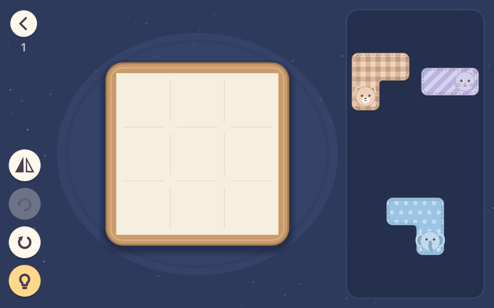

# Tuck-In

A cozy packing puzzle: tuck every softie into the crib before bedtime.

Each level gives you a board and a tray of plush toys ("softies"), each shaped like a polyomino. Drag, rotate and flip them until every softie fits on the board. Some softies have preferences, so it isn't enough to just fit them in:

- **Likes**: the softie must touch its target (a board feature, or another softie).
- **Dislikes**: the softie must not touch its target.

"Touching" means sharing an edge. There are 56 levels, and each one is checked to be solvable.



## Built with

- [Godot](https://godotengine.org) 4.7 (GL Compatibility renderer), written in GDScript
- Targets Android tablets and phones (arm64); also runs on desktop for development

## Running it

1. Install Godot 4.7.
2. Open this folder as a project, or run it from a terminal:

```bash
godot --path .
```

## Tests

```bash
godot --headless --path . --import              # once, and after adding a new class_name script
godot --headless --path . -s tests/run_tests.gd # unit tests
godot --headless --path . -s tools/verify_levels.gd # checks every level loads and is solvable
```

Both scripts exit non-zero on failure. [CI](.github/workflows/ci.yml) runs the import check, the tests and the level check on every push and pull request.

## Project layout

| Folder | Contents |
|---|---|
| `core/` | Game logic with no UI: shapes, board state, rules, level loading, solver |
| `game/` | The play screen: board, tray, pieces, HUD, tutorial coach |
| `ui/` | Menu, level select, settings, shelf |
| `art/` | Procedural drawing code for softies, faces, icons and fabrics |
| `autoload/` | Audio, scene routing and save data singletons |
| `levels/` | The 56 levels as JSON |
| `tools/` | Level generation, level verification, icon generation, end-to-end self test |
| `tests/` | Unit tests |

## Building for Android

An Android export preset is included in `export_presets.cfg`. It needs the Godot Android export templates, a JDK 17 and the Android SDK. Then:

```bash
godot --headless --path . --export-debug "Android" build/tuck-in-debug.apk
```

Keystores are not part of this repo (see `.gitignore`).

## License

[GPL 3.0](LICENSE)
